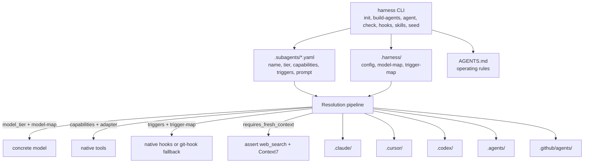
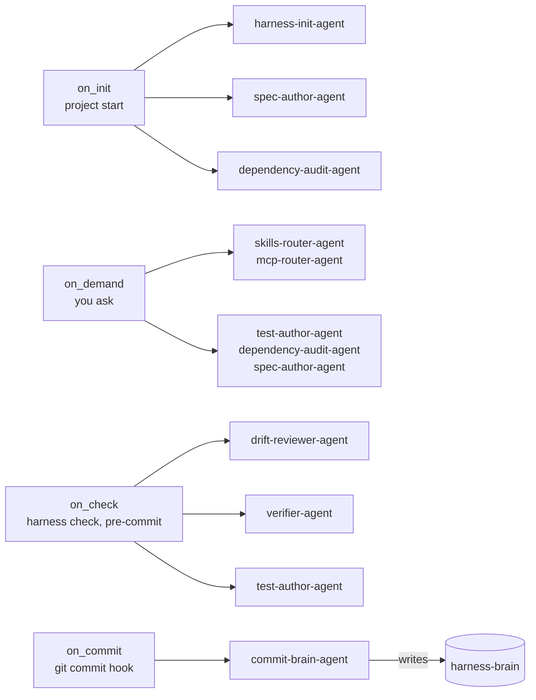

<div align="center">

# Harness Stack

**An AI-native, platform-agnostic engineering harness: spec-driven sub-agents you can drop into any project, on any agentic coding platform.**

[](https://github.com/exponen-agi/harness-stack/actions/workflows/ci.yml)
[](LICENSE)
[](https://nodejs.org)


[Quick start](#quick-start) ·
[How it works](#how-it-works) ·
[Agent catalog](#the-v1-agent-catalog) ·
[Docs](#documentation) ·
[Contributing](#contributing)

</div>

---

## Contents

- [What and why](#what-and-why)
- [Key features](#key-features)
- [Quick start](#quick-start)
- [Command reference](#command-reference)
- [Configuration](#configuration)
- [Optional: commit memory (harness-brain)](#optional-commit-memory-harness-brain)
- [Troubleshooting](#troubleshooting)
- [How it works](#how-it-works)
- [The v1 agent catalog](#the-v1-agent-catalog)
- [Project structure](#project-structure)
- [Development](#development)
- [Documentation](#documentation)
- [Contributing](#contributing)
- [Security](#security)
- [License](#license)

## What and why

Harness Stack keeps your AI coding tool honest. It checks that your tests
actually cover what you just changed, flags docs that fell out of sync with the
code, and remembers *why* past changes were made, so you and your team stop
re-explaining the codebase to your AI tool every session.

You run one command (`harness init`) inside your own repo. It works with
whatever AI coding tool you already use: Claude Code, Cursor, Codex,
Antigravity, or GitHub Copilot. No AI/ML background required.

Nothing here trains a model or calls a hosted service on your behalf. Harness
generates plain text files (YAML, Markdown, TOML) that your existing tool reads.
Open any generated file, read it in five minutes, delete it if you do not like it.

**Doesn't my AI coding tool already do this?** Not really. General-purpose
assistants help when you ask, and forget everything when the session ends.
Harness adds what a plain assistant does not do on its own:

- **It runs automatically**, wired into events you already trigger (`git commit`, project init), not only when you remember to ask.
- **It is made of small, single-job agents** (write missing tests, spot doc drift, log the "why") instead of one assistant doing everything from a blank slate.
- **It has memory across sessions and repos** via the optional [harness-brain](https://github.com/exponen-agi/harness-brain).
- **It behaves the same on every platform.** Switch from Claude Code to Cursor and the same checks still run.

If that is not a gap you feel today, you may not need this yet.

## Key features

| When you... | Harness... |
| --- | --- |
| Write new code and try to commit | Checks the change is covered by tests, and writes missing ones if you say yes |
| Change code but forget the docs | Catches doc, README and comment drift against the diff before it ships |
| Come back tomorrow (or a teammate does) | Has already logged *what changed and why*, so nobody re-explains context |
| Ask your AI tool for help | Routes the request to a small, focused specialist agent |
| Open a generated file | It is plain YAML/Markdown: readable, editable, deletable. Nothing hidden |

Under the hood:

- **Platform-agnostic by construction.** Agent specs name an abstract model tier and abstract capabilities; the active platform adapter resolves them.
- **Fresh-context by mandate.** Agents that reason about libraries, APIs, versions, or CVEs run with web search and Context7 wired, never stale training data.
- **Spec-driven by default.** Installs vetted foundations (Spec Kit and Superpowers) and surfaces their skills through a consent-gated recommendation protocol.
- **Auditable.** Every sub-agent is a diffable `.yaml` file in `.subagents/`.

## Quick start

Follow this top to bottom in **your own** project (full-stack app, backend, mobile app, library, anything).

### 1. Prerequisites

**Node.js 22.12 or newer** and **git**.

```bash
node -v     # must print v22.12.0 or higher
git --version
```

Install Node from [nodejs.org](https://nodejs.org) or with [nvm](https://github.com/nvm-sh/nvm)
(`nvm install 22 && nvm use 22`). Node 20 reached end-of-life in April 2026, so Harness no longer supports it.

### 2. Install the CLI

Harness Stack is not on the npm registry yet. One command installs it straight
from GitHub, with no clone and no build tools (the compiled output ships in the repo):

```bash
npm install -g https://github.com/exponen-agi/harness-stack/archive/refs/heads/main.tar.gz
```

> **On npm 12 or newer** (ships with recent Node on Windows), npm blocks URL
> installs and install scripts by default, so use:
>
> ```powershell
> npm install -g --allow-remote=all https://github.com/exponen-agi/harness-stack/archive/refs/heads/main.tar.gz
> ```
>
> You will see a warning that harness-stack's `prepare` script was blocked.
> That is safe to ignore: the script only rebuilds from source when dev tooling
> is present, and the compiled output already ships in the repo.

Confirm it worked:

```bash
harness --version
# 0.1.0
```

If `harness` is not recognized, it is almost always a `PATH` issue; see [Troubleshooting](#troubleshooting).

> **Why the `/archive/...tar.gz` URL instead of `npm install -g git+https://...`?**
> Current npm (v10/v11) has a bug installing git URLs globally: it links the
> package into npm's temporary cache directory (which is then cleaned) instead
> of copying it, so the `harness` command is never created. The tarball URL goes
> through npm's normal package-download path and produces a real install.

<details>
<summary><strong>Global install failed, or you would rather not install globally?</strong></summary>

- **Permission error (EACCES)**: re-run with `sudo`, or (recommended) fix npm's global prefix once by following the [official npm guide](https://docs.npmjs.com/resolving-eacces-permissions-errors-when-installing-packages-globally). An `nvm`-managed Node usually avoids this entirely.
- **Install from a local checkout** (also avoids the git-URL bug):
  ```bash
  git clone https://github.com/exponen-agi/harness-stack.git
  cd harness-stack
  npm pack
  npm install -g ./harness-stack-0.1.0.tgz   # PowerShell: .\harness-stack-0.1.0.tgz
  ```
- **No global install**: run from a clone instead:
  ```bash
  cd harness-stack && npm install
  npm link                 # makes `harness` available globally from this checkout
  # or, without linking, from inside harness-stack/:
  npm run harness -- <command>
  ```

</details>

### 3. Run `harness init` in your project

```bash
cd ~/code/my-backend-service
harness init
```

Harness always works on the directory you run it from. It asks a few questions:

```
? Which agentic platform(s) do you use? (space to select, enter to confirm)
  ◉ Claude Code
  ◯ Cursor
  ◯ Codex
  ◯ Antigravity
  ◯ GitHub Copilot

? Set up harness-brain (git-backed commit memory)? (y/N)
? Path for harness-brain [../harness-brain]:
```

Pick whichever tool(s) you use (you can pick several). harness-brain is
optional; say **no** on your first run and add it later. Afterwards your repo gains:

```
your-project/
├── .subagents/              ← the sub-agents, as readable YAML (edit these)
│   ├── harness-init-agent.yaml
│   ├── test-author-agent.yaml
│   └── ...
├── .harness/                ← Harness config (model map, trigger map, ...)
│   └── config.yaml
├── AGENTS.md                ← operating rules appended for your main AI agent
└── (everything else you already had, untouched)
```

### 4. Generate the files your AI tool reads

```bash
harness build-agents
```

This reads every file in `.subagents/` and writes the native files each chosen
platform expects. For Claude Code:

```
your-project/
└── .claude/
    ├── agents/      ← one file per sub-agent
    ├── skills/      ← decision-routable skills (auto-picked by the AI)
    └── commands/    ← manual slash commands, e.g. /verify
```

Other platforms produce `.cursor/`, `.codex/`, `.agents/`, or `.github/agents/`
(see [How it works](#how-it-works)). **Re-run `harness build-agents` after editing
any `.subagents/*.yaml`**: generated files are overwritten, so never hand-edit them.

### 5. Try it

Open your AI coding tool in the repo and either ask naturally ("review my recent
changes for missing tests"), or invoke a command directly. Use `harness skills`
to see the exact slash command for each agent (e.g. `/verify`, `/review-drift`).

```bash
harness skills      # agent -> files produced -> how to invoke it
harness agent list  # browse every registered sub-agent
harness hooks       # which native event (or git hook) triggers each agent
harness check --all # preview the pre-commit orchestration plan
harness doctor      # health check: what is wrong, and the exact command to fix it
```

> **Something not working?** Run `harness doctor` first. It only reads files
> (it never changes anything) and works the same on macOS, Windows, and Linux.
> It checks your Node.js and git, your agent specs, and whether the generated
> agent files are up to date. Each problem comes with the command to fix it.
> If it finds a real problem it exits with code `1`, so you can also use it in CI.

### 6. Commit the generated files

`.subagents/`, `.harness/`, `AGENTS.md`, and the platform folders are meant to be
committed: every teammate and PR reviewer can see exactly what each agent may do,
as a diffable text file.

```bash
git add .subagents .harness AGENTS.md .claude   # or whichever platform folder you generated
git commit -m "Add Harness sub-agents"
```

## Command reference

| Command | Purpose |
| --- | --- |
| `harness init` | Scaffold `.subagents/`, `.harness/` config and the foundation. Flags: `-p, --platform <platforms>` (comma-separated: `claude-code`, `cursor`, `codex`, `antigravity`, `copilot`; or set `HARNESS_PLATFORM`), `-y, --yes`, `--skip-foundation`, `--dry-run-foundation`, `--brain <path>`, `--brain-source <clone\|scaffold>`, `--brain-repo <url>`, `--skip-brain` |
| `harness build-agents` | Generate platform-native agent files from `.subagents/*.yaml`. Flag: `-p, --platform <platform>` (default: all configured) |
| `harness agent list` | Print (and refresh) the `.subagents/README.md` index |
| `harness agent create <task...>` | Discover-or-create an agent for a task (consent-gated). Flags: `-g, --goal <goal>`, `-y, --yes` |
| `harness check` | Compute the resource-aware orchestration plan. Flag: `--all` includes all `on_check` and `on_demand` reviewers |
| `harness hooks` | Show how agent triggers resolve to native event hooks. Flag: `-p, --platform` |
| `harness skills` | Show how agents are exposed as skills and slash commands. Flag: `-p, --platform` |
| `harness seed` | Print the iteration seed (north-star plus brain state) for loop and context reset. Flag: `--repo <name>` |

## Configuration

| File / variable | What it controls |
| --- | --- |
| `.subagents/*.yaml` | The canonical agent specs: name, model tier, capabilities, triggers, `expose_as`, prompt |
| `.harness/config.yaml` | Enabled platforms and the `brain:` setting |
| `.harness/model-map.yaml` | Maps abstract tiers (`fast` / `reasoning` / `deep` / `inherit`) to concrete models per platform. Model names live only here |
| `.harness/trigger-map.yaml` | Maps abstract triggers to each platform's native hooks (or a Harness fallback) |
| `HARNESS_PLATFORM` | Platform(s) to use when `--platform` is omitted at `init` |
| `HARNESS_BRAIN_PATH` | Location of your harness-brain checkout |

## Optional: commit memory (harness-brain)

Harness can keep a running, human-readable log of *what changed and why* across
your commits, written by `commit-brain-agent` into a companion repository,
[harness-brain](https://github.com/exponen-agi/harness-brain). It is entirely opt-in.

```bash
harness init --brain ../harness-brain                     # clone the shared example repo
harness init --brain ./memory --brain-source scaffold     # local skeleton, no network needed
harness init --skip-brain                                 # skip it (default if you say "no")
```

- **clone** pulls the harness-brain repo, complete with worked examples.
- **scaffold** creates the same folder structure locally and offline.

The choice is saved under `brain:` in `.harness/config.yaml`. Point the agents at it with:

```bash
export HARNESS_BRAIN_PATH=/path/to/harness-brain
```

See the [harness-brain README](https://github.com/exponen-agi/harness-brain#readme) for details.

## Troubleshooting

| Problem | Fix |
| --- | --- |
| Installed with `npm install -g git+https://...` — install reported success but `harness` is "not recognized" / "command not found" | This is the npm git-URL global-install bug described in Quick start step 2: npm links the package into its temporary cache (later cleaned) instead of copying it, and never creates the `harness` launcher. Run `npm uninstall -g harness-stack` to clear the broken install, then use Quick start step 2's `/archive/...tar.gz` one-liner. |
| Installed with the Quick start step 2 one-liner, but `harness` is "not recognized" / "command not found" | npm's global bin folder isn't on your `PATH`. On Windows, follow the [walkthrough below](#windows-path). On macOS/Linux: `npm config get prefix`, then add `<that path>/bin` to your shell's `PATH`. |
| `Could not determine Node.js install directory` (Windows) | Your npm launcher can't find its own Node install — classic symptom of a self-updated npm under `%APPDATA%\npm` clashing with the npm bundled with Node. See the [fix below](#windows-npm-broken). |
| `npm warn install-scripts ... prepare: node scripts/prepare.mjs ... blocked` (npm 12+) | Harmless — see the note in Quick start step 2. The blocked script only rebuilds from source when dev tooling is present; the shipped compiled output is used either way. Add `--allow-scripts=harness-stack` if you want the warning gone. |
| Older install attempts failed building (`'tsc' is not recognized`, or `Cannot find module '...\node_modules\typescript\bin\tsc'`) | Earlier versions built from source at install time, and npm's git-dependency prepare step doesn't install the devDependencies that build needs. Fixed on `main`: the compiled `dist/` now ships in the repo, so *global* installs never build. Re-install per Quick start step 2. (A normal `git clone` + `npm install` for development still builds, which is intended — it just needs the devDependencies that a clone installs anyway.) |
| `harness build-agents` fails with a fresh-context error | An agent needs a web-search tool + Context7 and your platform doesn't expose one yet. Re-run `harness init` and make sure you picked the right platform(s). |
| Nothing happens when I ask my AI tool to use a sub-agent | Run `harness skills` — if the agent is command-only (not a "skill"), you need to invoke its slash command directly. |
| I want to update to the latest Harness version | Re-run Quick start step 2's one-liner — the `/archive/refs/heads/main.tar.gz` URL always serves the current `main`. If npm seems to have served you a stale cached copy, run `npm cache clean --force` first and re-install. |

<a id="windows-path"></a>

### Windows: install succeeded but `harness` is "not recognized"

npm puts global launchers in its *prefix* folder on Windows (usually
`C:\Users\<you>\AppData\Roaming\npm`), and that folder must be on your
`PATH`. Node's installer normally adds it, but repairs/reinstalls or PATH
edits can drop it. Diagnose in PowerShell:

```powershell
npm prefix -g                             # where the launchers go
Test-Path "$env:APPDATA\npm\harness.cmd"  # does the launcher exist?
```

- **`True`** → the install is fine; the folder just isn't on `PATH`.
  Fix the current session, verify, then make it permanent:

  ```powershell
  $env:Path += ";$env:APPDATA\npm"
  harness --version          # should print the version now

  # make it permanent for future terminals:
  [Environment]::SetEnvironmentVariable(
    "Path",
    [Environment]::GetEnvironmentVariable("Path", "User") + ";$env:APPDATA\npm",
    "User"
  )
  ```

  Then open a fresh terminal and run `harness --version` once more.

- **`False`** → the launcher wasn't created. Most likely a broken leftover
  from an earlier `git+https` install is in the way. Clean it out and
  reinstall fresh (should report "**added** N packages", not "changed"):

  ```powershell
  npm uninstall -g harness-stack
  Remove-Item "$env:APPDATA\npm\node_modules\harness-stack" -Recurse -Force -ErrorAction SilentlyContinue
  Remove-Item "$env:APPDATA\npm\harness*" -Force -ErrorAction SilentlyContinue
  npm install -g --allow-remote=all https://github.com/exponen-agi/harness-stack/archive/refs/heads/main.tar.gz
  ```

<a id="windows-npm-broken"></a>

### Windows: `Could not determine Node.js install directory`

This means the `npm` command itself is broken — it fails before even
reading what you asked it to install. The usual cause is a self-updated
npm living in `%APPDATA%\npm` (from running `npm install -g npm` at some
point) that has fallen out of sync with the Node installation in
`C:\Program Files\nodejs`. Remove the shadowing copy so Node's own bundled
npm takes over:

```powershell
Remove-Item "$env:APPDATA\npm\npm*" -Force
Remove-Item "$env:APPDATA\npm\npx*" -Force
Remove-Item "$env:APPDATA\npm\node_modules\npm" -Recurse -Force
```

Close and reopen PowerShell, confirm `npm -v` prints a version again, then
re-run the Quick start step 2 install. If `npm -v` still fails, re-run the Node
installer from [nodejs.org](https://nodejs.org) and choose **Repair**.
Going forward, avoid `npm install -g npm` on Windows — let the Node
installer manage npm's version.

## How it works

`.subagents/*.yaml` is the single source of truth. `harness build-agents` resolves
each abstract field against the active platform and writes native files.



The generated layout per platform:

```
.subagents/<agent>.yaml            <- canonical, platform-agnostic source of truth
        |  harness build-agents
        v
.claude/agents/<name>.md           <- Claude Code  (sub-agent, YAML frontmatter)
.cursor/agents/<name>.md           <- Cursor       (sub-agent, YAML frontmatter)
.codex/agents/<name>.toml          <- Codex        (custom agent, TOML)
.agents/skills/<name>/SKILL.md     <- Antigravity  (Agent Skill, the sub-agent)
.github/agents/<name>.agent.md     <- Copilot      (custom agent, the sub-agent)

.claude/skills/<command>/SKILL.md  <- decision-routed skill  (when expose_as has "skill")
.claude/commands/<command>.md      <- manual slash command    (when expose_as has "command")
   (per-platform native paths for skill/command: see the table below;
    on Antigravity & Copilot the sub-agent above IS the decision-routed skill)
```

- **Edit the YAML, not the generated files.** Generated files are overwritten on every build.
- **Model names live in one place**: `.harness/model-map.yaml`. Update the map, nothing else changes.
- **Capabilities are abstract** (`read` / `write` / `exec` / `web_search` / `web_fetch`); the adapter maps them to native tools.
- **Triggers are abstract** (`on_init` / `on_commit` / `on_check` / `on_demand`); see below.

### Agent lifecycle by trigger



`drift-reviewer-agent` and `verifier-agent` also declare `on_demand`, so you can
invoke the verification pair directly (`/review-drift`, `/verify`) as well as via
the `on_check` gate.

### Triggers → native event hooks

Different platforms expose different event hooks. Agents declare abstract
triggers, and `.harness/trigger-map.yaml` resolves each to the active platform's
**native hook** — or, where the platform has no equivalent, to a Harness
fallback (an installed **git hook** for `on_commit`, or `harness check` for
`on_check`). Run `harness hooks` to see the wiring plan.

Because hook APIs drift, the map ships with best-known defaults flagged
`verified: false`; at `init` the `harness-init-agent` **researches the chosen
platform's current hook docs** (search + Context7) and refreshes the map before
wiring. This is why `init` asks which platform you use first.

### Agents as skills & slash commands

A sub-agent is always generated. Beyond that, each agent declares how it can be
**invoked**, via `expose_as` in its `.subagents/*.yaml`:

- **`skill`** — a **decision-routed** surface the main agent can choose to run.
- **`command`** — a **manual** slash command you invoke directly.

Both are **thin launchers** that hand off to the same sub-agent, so the
`.subagents` prompt stays the single source of truth. The name is `command:` (or
the agent name minus `-agent`). Run **`harness skills`** to see each agent's
surfaces. Each platform's surfaces use that platform's **native, verified**
mechanism:

| Platform | `skill` (decision-routed) | `command` (manual) |
| --- | --- | --- |
| Claude Code | `.claude/skills/<c>/SKILL.md` | `.claude/commands/<c>.md` → `/<c>` |
| Cursor (2.4) | `.cursor/skills/<c>/SKILL.md` | `.cursor/commands/<c>.md` → `/<c>` |
| Codex | `.agents/skills/<c>/SKILL.md` (implicit) | same skill, explicit `$<c>` (`allow_implicit_invocation: false`) |
| Antigravity | *the sub-agent* `.agents/skills/<name>/SKILL.md` | `.agents/workflows/<c>.md` → `/<c>` |
| GitHub Copilot | *the sub-agent* `.github/agents/<name>.agent.md` | `.github/prompts/<c>.prompt.md` → `/<c>` |

On **Antigravity and Copilot the sub-agent file is already the decision-routed
skill**, so no separate thin skill is emitted — only the manual command. On
Claude/Cursor/Codex the skill is a separate thin launcher. Cursor, Codex, and
Antigravity all read the portable **Agent Skills** standard (`SKILL.md`).
Defaults: light routing agents (`skills-router`, `mcp-router`,
`commit-brain`) and the pre-commit verification pair (`drift-reviewer`,
`verifier`) are exposed as **both** a skill and a command — the pair need to be
decision-routable on `on_check`; heavier fresh-context agents (`harness-init`,
`dependency-audit`, `spec-author`, `test-author`) get a **manual command** only
— so the model doesn't auto-launch an expensive job.

As with hooks, mechanisms drift, so the bundled mappings are verified now and the
`harness-init-agent` **re-checks them at init** (search + Context7).

### Fresh-context enforcement

Any agent with `requires_fresh_context: true` must resolve a web-search tool
**and** have Context7 available, or `harness build-agents` fails with an
actionable error. Context7 is installed as a base MCP at `init`, and the
operating-rules fragment written into `AGENTS.md` extends the rule to the main
agent.

### Discovery & reuse

`harness agent create <task>` follows reuse-before-create:

1. **Exact match** by name -> reuse.
2. **Similar match** (overlap score >= 0.75) -> offer to reuse/extend.
3. **Create new** -> consent-gated scaffold, then regenerate the README index.

### Resource-aware orchestration

`harness check` computes the parallel batch: CPU cap (`cores - 1`), a 70%
free-memory budget (per-agent `max_memory_mb` hints, 256 MB default),
high-priority first, non-parallelizable agents sequenced.

### Agentic loops (context reset + verification gate)

Harness sits *beneath* an agentic loop and supplies its disciplines without
building an uncontrolled one. `harness seed` materializes the **iteration
seed** — the stable north-star (from `.harness/SEED.md`, a Spec Kit spec, or the
README) plus the brain's compact rollup as the current-state digest — so each
iteration re-seeds from a source of truth instead of drifting on its own
transcript. The `drift-reviewer-agent` (semantic) and `verifier-agent`
(executable) form the independent stop/continue gate on `on_check`. Human-in-
the-loop is the default; the autonomous controller is opt-in and deferred. See
[`docs/agentic-loop.md`](docs/agentic-loop.md).

## The v1 agent catalog

| Agent | Tier | Purpose |
| --- | --- | --- |
| `harness-init-agent` | reasoning | Classify project, gap report, install base tooling |
| `spec-author-agent` | reasoning | Drive Spec Kit constitution -> spec -> plan -> tasks |
| `skills-router-agent` | fast | Rank skills across sources, consent-gated |
| `mcp-router-agent` | fast | Rank MCP servers from the curated allowlist |
| `commit-brain-agent` | fast | Write per-commit summaries into `harness-brain` |
| `dependency-audit-agent` | reasoning | Maintain `DEPENDENCIES.md` (latest / outdated / deprecated / EOL) from live data |
| `test-author-agent` | reasoning | Review unit tests, surface gaps, author missing tests on consent |
| `drift-reviewer-agent` | reasoning | Pre-commit semantic check: flag/fix docstring, doc & low-level-design drift vs the diff (docs only) |
| `verifier-agent` | reasoning | Pre-commit executable check: independently confirm the change is covered by passing tests (no `write`; delegates authoring to `test-author-agent`, owns the verdict) |

See [`docs/spec-subagents.md`](docs/spec-subagents.md) for the full design spec and the Phase 2/3 catalog. New to AI agents? Read [`docs/factories-as-code.md`](docs/factories-as-code.md) first.

## Project structure

```
harness-stack/
├── src/
│   ├── cli.ts            ← CLI entry (commander)
│   ├── schema.ts         ← canonical .subagents/*.yaml shape (Zod)
│   ├── adapters/         ← one file per platform (claude-code, cursor, codex, antigravity, copilot)
│   ├── resolution/       ← model-tier / capability / trigger / fresh-context resolvers
│   ├── commands/         ← what each `harness <command>` does
│   ├── orchestrator/     ← resource-aware scheduler
│   ├── discovery/        ← reuse-before-create agent discovery
│   ├── foundation/       ← Spec Kit, Superpowers, git hooks
│   ├── skills/ loop/ brain/ util/
├── templates/
│   ├── agents/*.yaml     ← the shipped v1 agent specs (the "product")
│   ├── allowlists/ evals/ brain/
│   ├── model-map.yaml  trigger-map.yaml  AGENTS.fragment.md
├── scripts/              ← prepare, verify-dist, check-brain-template, eval-agents
├── tests/                ← vitest suites
├── docs/                 ← design docs and the GitHub Pages landing page
└── dist/                 ← compiled output (committed on purpose)
```

## Development

Requires Node.js 22+ (see `.nvmrc`), npm and git.

```bash
git clone https://github.com/exponen-agi/harness-stack.git
cd harness-stack
npm install
npm test
```

| Script | Purpose |
| --- | --- |
| `npm run lint` / `lint:fix` | ESLint over `src` and `tests` |
| `npm run typecheck` | `tsc --noEmit` |
| `npm test` / `test:watch` | Vitest |
| `npm run build` | Compile to `dist/` |
| `npm run harness -- <command>` | Run the CLI from source |
| `npm run eval:agents` | Lint and validate the shipped agent specs (CI uses `-- --strict`) |
| `npm run verify:dist` | Fail if committed `dist/` differs from a fresh build |
| `npm run verify:brain-template` | Diff `templates/brain/` against the harness-brain repo (sibling `../harness-brain`, a path argument, or `HARNESS_BRAIN_DIR`) |

CI (`.github/workflows/ci.yml`) runs lint, typecheck, tests, spec evals and build
on Ubuntu, macOS and Windows with Node 22 and 24, plus a dependency audit,
a `dist/` integrity check and brain-template drift check. Before opening a PR:

```bash
npm run lint && npm run typecheck && npm test && npm run build && npm run eval:agents -- --strict
```

## Documentation

| Doc | Contents |
| --- | --- |
| [`docs/factories-as-code.md`](docs/factories-as-code.md) | Plain-English walkthrough of how a spec becomes a running agent and how evals keep specs honest. Start here |
| [`docs/spec-subagents.md`](docs/spec-subagents.md) | Full design spec and Phase 2/3 catalog |
| [`docs/agentic-loop.md`](docs/agentic-loop.md) | How Harness relates to agentic-loop patterns |
| [`docs/index.html`](docs/index.html) | Landing page source |
| [`CHANGELOG.md`](CHANGELOG.md) | Release notes |
| [`CONTRIBUTING.md`](CONTRIBUTING.md) | Contribution guide |
| [`SECURITY.md`](SECURITY.md) | Security policy |
| [`CODE_OF_CONDUCT.md`](CODE_OF_CONDUCT.md) | Community standards |

## Contributing

Contributions are welcome and you do not need deep AI experience. Good starting
points: fixing a docs typo, adding a worked example, improving an error message,
or picking up a Phase 2 agent from [`docs/spec-subagents.md`](docs/spec-subagents.md).
`templates/brain/` is the offline scaffold and must stay in sync with the
[harness-brain](https://github.com/exponen-agi/harness-brain) example repo.

See [**CONTRIBUTING.md**](CONTRIBUTING.md) for branching, commit style and what a
good first PR looks like. Questions or ideas? Open a
[GitHub issue](https://github.com/exponen-agi/harness-stack/issues). Please follow
the [Code of Conduct](CODE_OF_CONDUCT.md).

## Security

Please do not open public issues for vulnerabilities. See [SECURITY.md](SECURITY.md)
for supported versions and how to report privately.

## License

MIT. See [LICENSE](LICENSE).
