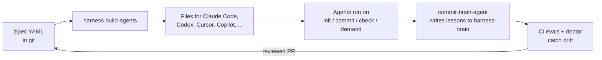

# Ecosystem notes (November 2026)

Plain-English notes for teams new to AI engineering. They explain what is
happening around Harness Stack, what we already do, and what we may do next.
Some numbers come from blog posts, not primary sources. We mark those
**(unverified)**. The MCP item is from the official spec.

## The one idea

> An AI agent = a **model** + a **harness**.
> The harness is everything around the model: instructions, tools, hooks,
> reviewers, tests and rules.

Teams report that changing only the harness can move benchmark scores a lot
**(unverified)**. So Harness Stack treats the harness as code: written in YAML,
reviewed in a PR, tested in CI.



## What we do now, and what is next

| Trend | Source | Harness Stack today | Next step (small) |
|---|---|---|---|
| MCP spec 2026-07-28: no session handshake; Sampling, Roots and Logging deprecated (still the latest spec in Nov 2026) | [official changelog](https://modelcontextprotocol.io/specification/2026-07-28/changelog) | Curated MCP allowlist, exact versions required (tested) | Warn if an agent spec needs Sampling or Roots |
| MCP and npm supply-chain attacks | security write-ups **(unverified)** | No `@latest`; eval gate pins `promptfoo` and `tsx`; read-only workflow permissions | Add a prompt-injection smoke scenario to the eval kit |
| `AGENTS.md` as the shared project file | Linux Foundation / blogs **(unverified)** | We already generate `AGENTS.md` | Make it the main output; keep other files thin |
| Evals in CI | [promptfoo docs](https://github.com/promptfoo/promptfoo/blob/main/site/docs/integrations/ci-cd.md) | Free spec checks plus paid promptfoo gate (fixed in this change to count errors) | Smoke eval on each PR, full eval on release |
| Model names change fast | all vendors | `model-map.yaml` is the only place with model names; `doctor` now warns when it is old | `harness update` to refresh from the shipped default |
| Self-improving memory: lessons become rules only after review | [arXiv 2607.13091](https://huggingface.co/papers/2607.13091); practitioner blogs **(unverified)** | `commit-brain-agent` logs every commit; **new:** `harness lessons` lists to-dos that repeat in 2+ commits, with file + SHA as evidence. Read-only | Let `on_check` write the proposed rule as a patch file for a PR (still never edit specs directly) |
| More CLI agents (OpenCode, Gemini CLI) | surveys **(unverified)** | 5 platforms | Add pass-through targets that read `AGENTS.md` |

## Commands that work the same on macOS, Linux and Windows

```bash
npm run eval:agents -- --strict   # free check of all agent specs
harness doctor                    # includes the model-name age check
harness lessons                   # repeated to-dos in harness-brain
```

On Windows, use PowerShell or Git Bash. Set the API key for paid evals with
`$env:ANTHROPIC_API_KEY = "..."` (PowerShell) or `export ANTHROPIC_API_KEY=...`
(macOS / Linux / Git Bash).
