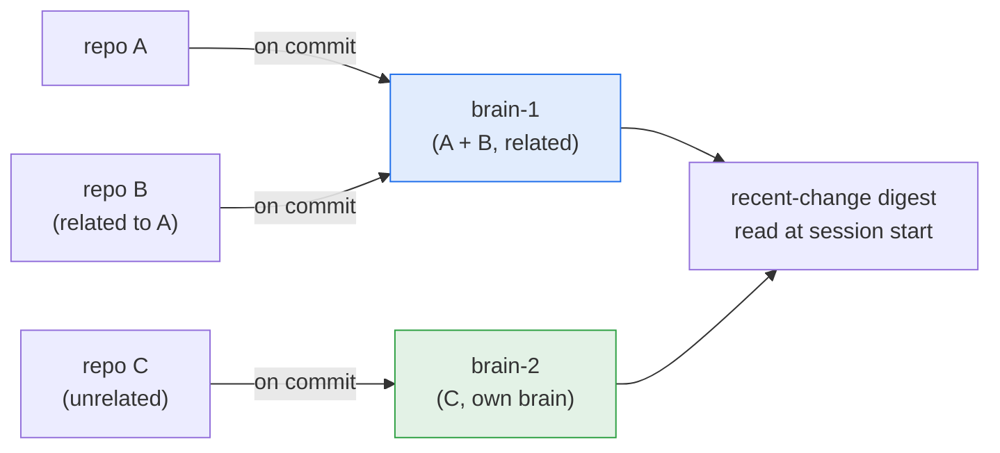

<div align="center">

# Harness Brain

**Your team's shared memory of "what changed and why" — plain Markdown, backed by git.**

[](LICENSE)
[](https://github.com/exponen-agi/harness-brain/actions/workflows/ci.yml)
[](package.json)
[](https://github.com/exponen-agi/harness-stack)
[](CONTRIBUTING.md)

[Quick start](#quick-start) ·
[How it works](#how-it-works) ·
[Repository layout](#repository-layout) ·
[Contributing](#contributing) ·
[Changelog](CHANGELOG.md)

</div>

---

## Table of contents

- [What and why](#what-and-why)
- [Key features](#key-features)
- [How it works](#how-it-works)
- [Quick start](#quick-start)
- [Brains: how repos are grouped](#brains-how-repos-are-grouped)
- [Files: detailed logs vs the compact rollup](#files-detailed-logs-vs-the-compact-rollup)
- [Templates and worked examples](#templates-and-worked-examples)
- [Repository layout](#repository-layout)
- [How it is written and read](#how-it-is-written-and-read)
- [Development](#development)
- [Contributing](#contributing)
- [Security](#security)
- [License](#license)

## What and why

Harness Brain is a plain-Markdown, git-backed log that
[Harness Stack](https://github.com/exponen-agi/harness-stack)'s
`commit-brain-agent` writes to automatically on every commit. The next person
(or your AI tool, at the start of a new session) can catch up in seconds
instead of re-reading `git blame` or re-explaining context from scratch.

There is no database, no hosted service and no background daemon: just a git
repo full of Markdown you can grep, diff and read like anything else.

| Situation | Without Harness Brain | With Harness Brain |
| --- | --- | --- |
| You open a repo you haven't touched in weeks | Scroll `git log`, guess at intent | Read one compact rollup file: recent changes, in plain English |
| Your AI tool starts a new session | Explain the whole backstory again | It reads a ready-made digest of recent changes across the repo (and related repos) |
| A product spans multiple repos (API + web client) | Check each repo's history separately | One shared "brain" covers all of them together |
| You want to know *why* a change was made 3 weeks ago | Dig through PR descriptions | Read the dated, per-repo detailed log entry |

**Isn't this just `git log`?** Close, but not quite:

- **Commit messages describe one commit in isolation.** The compact rollup
  summarizes the *state* across many commits and repos, kept current.
- **It is cross-repo.** If your product is split across an API and a web
  client, `git log` for one repo never mentions the other. A shared brain
  covers both together.
- **It is built to be machine-read, not just human-read.** Harness Stack's
  tooling can consume the compact rollup at session start, so no one has to
  remember to go read a changelog.

If your project is a single small repo and you don't use Harness Stack's
agents, plain `git log` may be enough, and that is fine.

## Key features

- **Plain Markdown in git.** Greppable, diffable, reviewable in a PR. No
  service to run.
- **Two layers of detail.** A per-repo, per-day *detailed log* (the audit
  trail) and one *compact rollup* per brain (the current-state digest).
- **Cross-repo grouping.** Related repos share one numbered brain; unrelated
  repos each get their own.
- **Never blocks a commit.** The writer agent logs to stderr and exits 0 on any
  error.
- **Validated content.** `npm run validate` checks required fields, short
  SHAs, real calendar dates and rollup/folder agreement; CI runs it on Linux,
  macOS and Windows.
- **Zero dependencies.** The only code is two Node scripts using built-in
  modules (Node 22+).

## How it works

Each commit in a project repo is recorded by `commit-brain-agent` into the
brain that repo belongs to. The brain holds both the detailed log and the
compact rollup; the rollup is what gets read back at the start of new work.



The two file kinds map onto an agentic loop's externalized state:

- The **compact rollup** is the *current-state digest*: small and current. It
  is what `harness seed` re-injects at the start of each loop iteration.
- The **detailed log** is the *audit trail*: append-only, read when a human
  needs the full why, and never fed into the iteration seed.

See `harness-stack/docs/agentic-loop.md` for how the seed and verification
gate use these.

```mermaid
flowchart TB
    subgraph write["Write path (every commit)"]
        direction LR
        COMMIT["commit in a project repo"] --> AGENT["commit-brain-agent"]
    end
    subgraph brain["projects/&lt;brain&gt;/"]
        direction TB
        LOG["&lt;repo&gt;/YY-MM-DD-HAR.md<br/>detailed log, append-only"]
        ROLL["YY-MM-DD-HAR-compact.md<br/>one rollup per brain"]
    end
    subgraph read["Read path (session start)"]
        direction LR
        SEED["harness seed or manual read"] --> CTX["AI tool / teammate context"]
    end
    AGENT -->|"appends entry"| LOG
    AGENT -->|"refreshes block"| ROLL
    ROLL -->|"current-state digest"| SEED
    LOG -.->|"full why, on demand"| CTX
```



## Quick start

There are two ways to set this up.

### Path A: you use Harness Stack (recommended)

If the [`harness`](https://github.com/exponen-agi/harness-stack) CLI is already
installed in your project, it can set up harness-brain as part of
`harness init`:

```bash
cd your-project
harness init --brain ../harness-brain                     # clone this repo, with worked examples
# or
harness init --brain ./memory --brain-source scaffold     # generate the same structure locally, offline
```

Full details of the `init` flow are in the
[Harness Stack README](https://github.com/exponen-agi/harness-stack#optional-commit-memory-harness-brain).

### Path B: standalone setup

Use this if you want to inspect the structure first, wire it up by hand, or
contribute a new worked example.

**Step 1. Clone this repo** (anywhere on disk; it does not need to live next to
your project):

```bash
git clone https://github.com/exponen-agi/harness-brain.git ../harness-brain
```

**Step 2. Point your project's agent at it**, so `commit-brain-agent` knows
where to write:

```bash
export HARNESS_BRAIN_PATH=/absolute/path/to/harness-brain
```

Add that line to your shell profile (`~/.bashrc`, `~/.zshrc`, ...) so it
persists across terminal sessions.

**Step 3. Decide where your repo belongs.** Look at [`projects/`](projects) and
ask: *is this repo related to another repo already in a brain* (for example an
API and its web client: same product, different repos)?

- **Yes** → add your repo as a new folder **inside that repo's existing
  brain** (e.g. `projects/brain-1/your-repo/`).
- **No, it is independent** → give it its **own new brain**: the next unused
  number under `projects/` (e.g. if `brain-1` to `brain-3` exist, create
  `projects/brain-4/your-repo/`).

**Step 4. Bootstrap the folder** from the templates in
[`_templates/`](_templates):

```bash
mkdir -p projects/brain-4/your-repo
cp _templates/YY-MM-DD-HAR.md projects/brain-4/your-repo/26-07-03-HAR.md
# fill in the placeholders, following the worked examples under projects/
```

Then create (or update) the brain's **single** compact rollup at
`projects/brain-4/26-07-03-HAR-compact.md` from
[`_templates/YY-MM-DD-HAR-compact.md`](_templates/YY-MM-DD-HAR-compact.md): one
block per repo in the brain (see the
[worked example](projects/brain-1/26-06-07-HAR-compact.md)).

**Step 5. Commit and push.** From here on, if Harness Stack's
`commit-brain-agent` is set up (Path A does this automatically), it appends to
your detailed log and refreshes the compact rollup on every commit.

### Troubleshooting

| Problem | Fix |
| --- | --- |
| Agent isn't writing to the brain | Confirm `HARNESS_BRAIN_PATH` is set and exported in the shell your AI tool runs in, not just a one-off terminal. |
| Not sure if two repos are "related" | Ask: does one depend on or get deployed with the other, or are they described as the same product? If yes, same brain. If they make sense in separate contexts with no shared history, separate brains. |
| Adding a *new* repo to an existing brain | Same as Steps 3 and 4: add `projects/<existing-brain>/<new-repo>/` and a block in that brain's compact rollup. |

## Brains: how repos are grouped

A **brain** is a numbered folder under `projects/` that groups repositories.

- **Related repos share one brain.** A product split across several
  repositories (e.g. an API and its web client) puts all of them in the
  **same** brain, so they are read together.
- **Unrelated repos each get their own brain.** Independent projects live in
  separate numbered brains (`brain-2`, `brain-3`, ...) and are digested in
  isolation.

| Scenario | Example | What it shows |
| --- | --- | --- |
| **Related**: one product, many repos | [`brain-1/`](projects/brain-1): `ledger-api` + `ledger-web` | Two repos of one product (Ledger) in **one** brain; `web` depends on `api`, read together. |
| **Unrelated**: independent repos | [`brain-2/`](projects/brain-2): `weather-cli`; [`brain-3/`](projects/brain-3): `markdown-linter` | Each unrelated repo in its **own** numbered brain. |

## Files: detailed logs vs the compact rollup

Each brain holds two kinds of file:

- **Detailed per-repo log**: one folder per repo, with dated entries named
  `YY-MM-DD-HAR.md`. Full content: what, why, files, cross-repo impact, flags.
  This is the source of record, appended per commit.
- **Compact brain rollup**: a **single** file at the brain root,
  `YY-MM-DD-HAR-compact.md`, regenerated daily. It is structured by project and
  carries the one-line-per-change view across the whole brain.

All dates are **fully numeric**: `YY-MM-DD` (e.g. `26-06-07` = 2026-06-07).

## Templates and worked examples

| Path | Use it for |
| --- | --- |
| [`_templates/YY-MM-DD-HAR.md`](_templates/YY-MM-DD-HAR.md) | Format of a detailed per-repo entry |
| [`_templates/YY-MM-DD-HAR-compact.md`](_templates/YY-MM-DD-HAR-compact.md) | Format of a brain-level compact rollup |
| [`projects/`](projects) | Worked examples with fictional data: the related-repos case ([`brain-1`](projects/brain-1)) and the unrelated-repos case ([`brain-2`](projects/brain-2), [`brain-3`](projects/brain-3)). Start at the [`projects/README.md`](projects/README.md) index. |

Copy a template to start a new entry, then use the matching worked example as a
model for tone and level of detail. Real brains bootstrap their own folders,
READMEs and rollups on a repo's first commit.

## Repository layout

```text
harness-brain/
├── README.md
├── CHANGELOG.md · CONTRIBUTING.md · SECURITY.md · CODE_OF_CONDUCT.md · LICENSE
├── package.json                       ← scripts only; zero dependencies
├── .github/                           ← CI workflow, issue/PR templates, CODEOWNERS
├── scripts/
│   ├── validate-entries.mjs           ← content validator (npm run validate)
│   ├── check-stack-template-drift.mjs ← mirror parity check (npm run verify:stack-template)
│   └── *.test.mjs                     ← unit tests (npm test)
├── _templates/
│   ├── YY-MM-DD-HAR.md                ← detailed per-repo entry format
│   └── YY-MM-DD-HAR-compact.md        ← brain-level compact rollup format
└── projects/
    ├── README.md                      ← brains index
    ├── brain-1/                       ← RELATED repos (one product) share a brain
    │   ├── README.md                  ← brain index: product + member repos
    │   ├── 26-06-07-HAR-compact.md    ← single compact rollup (all repos)
    │   ├── ledger-api/
    │   │   ├── README.md
    │   │   └── 26-06-07-HAR.md        ← detailed log
    │   └── ledger-web/
    │       ├── README.md
    │       └── 26-06-07-HAR.md
    ├── brain-2/                       ← UNRELATED repo → its own brain
    │   ├── README.md
    │   ├── 26-06-05-HAR-compact.md
    │   └── weather-cli/
    │       ├── README.md
    │       └── 26-06-05-HAR.md
    └── brain-3/                       ← another UNRELATED repo → another brain
        ├── README.md
        ├── 26-06-03-HAR-compact.md
        └── markdown-linter/
            ├── README.md
            └── 26-06-03-HAR.md
```

Conventions: one brain per group of related repos (`brain-1`, `brain-2`, ...);
one folder per repo inside its brain; one detailed log per repo per day
(multiple commits on the same day append to that day's file); one compact
rollup per brain.

## How it is written and read

**Written.** The `commit-brain-agent` (defined in `harness-stack/.subagents/`)
runs on `on_commit`, reads the diff and commit message, appends a detailed
entry to the repo's `YY-MM-DD-HAR.md`, and refreshes its brain's
`YY-MM-DD-HAR-compact.md` rollup. It is designed to **never block a commit**:
on any error it logs to stderr and exits 0. Point it at this repo with:

```bash
export HARNESS_BRAIN_PATH=/path/to/harness-brain
```

**Read.** Today, reading the brain is manual: point your AI tool at the compact
rollup (`projects/<brain-n>/<YY-MM-DD>-HAR-compact.md`) and, when you need the
full story behind an entry, the matching detailed log
(`projects/<brain-n>/<repo>/<YY-MM-DD>-HAR.md`). `harness seed` in harness-stack
already does this for the current repo; see
[`docs/agentic-loop.md`](https://github.com/exponen-agi/harness-stack/blob/main/docs/agentic-loop.md).

A `cross-repo-discovery-agent` that automates this at session start (locating
the repo's brain and digesting every repo in it, related repos read together)
is planned but **not shipped yet** (Phase 2; see
[`docs/spec-subagents.md`](https://github.com/exponen-agi/harness-stack/blob/main/docs/spec-subagents.md)
in harness-stack).

## Development

This repo is plain Markdown with no dependencies. The only code is Node scripts
(Node 22+, built-in modules only):

```bash
git clone https://github.com/exponen-agi/harness-brain.git
cd harness-brain

npm run validate               # check entries: required fields, SHAs, dates, rollup/folder agreement
npm test                       # unit tests for the scripts
npm run verify:stack-template  # compare against a sibling ../harness-stack checkout (or set HARNESS_STACK_DIR)
```

CI ([`ci.yml`](.github/workflows/ci.yml)) checks brain structure and file
naming, runs the tests and validator on Linux, macOS and Windows, and
best-effort verifies parity with harness-stack's mirror.

harness-stack keeps an offline mirror of this repo's `README.md`, `_templates/`
and `projects/` at `templates/brain/` and checks that the two stay
byte-identical. A change to any of those three may need a companion PR there;
see [Keeping harness-stack in sync](CONTRIBUTING.md#keeping-harness-stack-in-sync).

## Contributing

Contributions are welcome, and code experience is optional. Good starting
points:

- **Add a worked example** under `projects/`: a new "related repos" or
  "unrelated repos" scenario helps more than another paragraph of prose.
- **Improve `_templates/`**, the entry formats every real brain follows.
- **Improve this README.** If a step confused you, tell us where.
- **Work on the agents** in
  [harness-stack](https://github.com/exponen-agi/harness-stack):
  `commit-brain-agent` is shipped; `cross-repo-discovery-agent` is planned.

Read [CONTRIBUTING.md](CONTRIBUTING.md) for the file rules and PR style, and
the [Code of Conduct](CODE_OF_CONDUCT.md). Questions? Open a
[GitHub issue](https://github.com/exponen-agi/harness-brain/issues).

## Security

Please do not report vulnerabilities in a public issue. Use GitHub's
[private vulnerability reporting](https://github.com/exponen-agi/harness-brain/security/advisories/new);
details are in [SECURITY.md](SECURITY.md).

## License

[MIT](LICENSE). See the [CHANGELOG](CHANGELOG.md) for notable changes.
